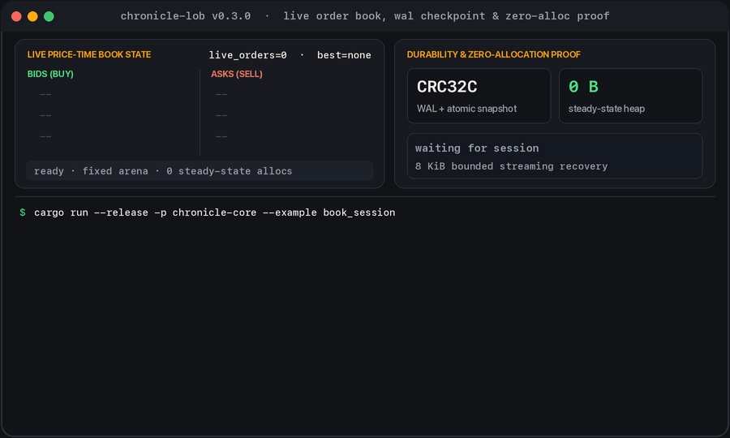
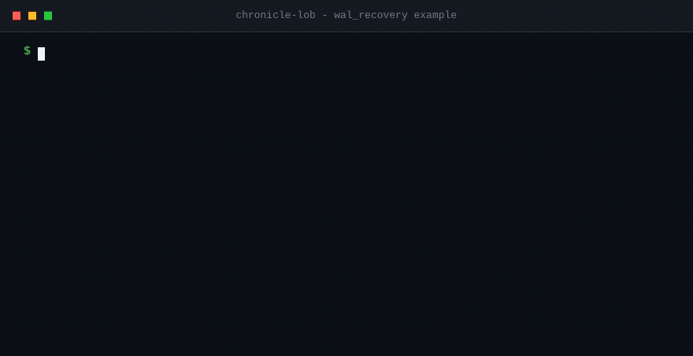

<p align="center">
  <a href="https://github.com/david-engelmann/chronicle-lob">
    <picture>
      <source media="(prefers-color-scheme: dark)" srcset="docs/media/chronicle-lockup-dark.svg">
      
    </picture>
  </a>
</p>

<h3 align="center">Deterministic limit order book and matching engine in Rust, with zero hot-path allocation.</h3>

<p align="center">
  <code>chronicle-lob</code> maintains a single-market price-time limit order book on a bounded integer tick grid, matches incoming orders against resting liquidity, persists every accepted command to a checksummed write-ahead log, and rebuilds exact book state across crashes and checkpoints in bounded memory.
</p>

<p align="center">
  <a href="docs/README.md"><b>Docs</b></a> ·
  <a href="docs/ARCHITECTURE.md">Architecture</a> ·
  <a href="docs/INVARIANTS.md">Invariants</a> ·
  <a href="docs/PERFORMANCE.md">Performance</a> ·
  <a href="https://github.com/david-engelmann/chronicle-lob/releases">Releases</a>
</p>

<p align="center">
  <a href="https://github.com/david-engelmann/chronicle-lob/actions/workflows/ci.yml?query=branch%3Amain"></a>
  <a href="https://crates.io/crates/chronicle-core"></a>
  <a href="https://docs.rs/chronicle-core"></a>
  <a href="LICENSE-MIT"></a>
</p>

<p align="center">
  
</p>

<p align="center"><sub>Every terminal line above comes from real runs of the <code>book_session</code> and <code>wal_recovery</code> examples and the <code>alloc_proof</code> test target, pinned and checked in continuous integration on Linux, macOS, and Windows.</sub></p>

## Why chronicle-lob

Order books sit on the critical path of exchanges, matching simulators, risk gates, and historical replay pipelines. General-purpose collection types allocate on the heap during bursts, scatter resting orders across cache lines, and drift when hash iteration or wall-clock calls enter matching logic. `chronicle-lob` fixes memory layout up front and treats determinism as a hard invariant rather than an accident.

- **Strict price-time priority.** Buy and sell orders rest on a bounded integer tick grid and match by best price first and arrival order second, always executing at the resting maker price.
- **Zero steady-state heap allocation.** Orders live in a preallocated struct-of-arrays arena indexed by 32-bit slot indices, active price levels sit under a 64-ary hierarchical bitmap (`O(bitmap depth)` best-price and sparse level walks), and events write into a caller-owned `EventBuffer`.
- **Atomic preflight before mutation.** Every command checks grid bounds, capacity, fill-or-kill liquidity, post-only crossing, and event buffer room before touching book state. A rejected command mutates nothing, emits zero events, and leaves sequence numbers untouched.
- **Four order types, priority-aware amend, mass cancel, and self-trade prevention.** Supports `Limit`, `Ioc`, `Fok`, and `PostOnly` orders, quantity reductions that keep FIFO priority, price or size increases that re-queue at tail, single-call participant mass cancel, and per-order self-trade prevention policies.
- **Crash-safe persistence in bounded memory.** `chronicle-wal` frames commands with Castagnoli CRC32C checksums, writes atomic snapshots and verified checkpoints, rejects crafted corrupt snapshots unconditionally in both debug and release builds, and streams verification, replay, and crash recovery in roughly 8 KiB of buffer space.
- **Pure standard-library core.** `chronicle-core` has zero external dependencies, forbids `unsafe` code, reads no clock, and draws no ambient randomness.

<p align="center">
  <picture>
    <source media="(prefers-color-scheme: dark)" srcset="docs/media/guarantees-dark.svg">
    
  </picture>
</p>

## How it works

<p align="center">
  <picture>
    <source media="(prefers-color-scheme: dark)" srcset="docs/media/how-it-works-dark.svg">
    
  </picture>
</p>

| Crate | Kind | External runtime deps | Role |
| --- | --- | --- | --- |
| [`chronicle-core`](crates/chronicle-core/README.md) | library | none (`std` only) | Deterministic matching engine, 64-ary hierarchical bitmaps, SoA order arena, zero-allocation L2 and L3 book queries, and independent `ReferenceBook` differential oracle. |
| [`chronicle-wal`](crates/chronicle-wal/README.md) | library | none (`std` only) | Slicing-by-8 CRC32C write-ahead log, atomic snapshot codec with unconditional invariant checks, multi-cycle checkpointing, and bounded-memory streaming recovery. |
| [`chronicle-lob-cli`](crates/chronicle-cli/README.md) | binary (`chronicle-cli`) | `clap`, `serde`, `serde_json` | Operator CLI for `verify`, `replay`, `snapshot`, `checkpoint`, and seeded synthetic `bench` runs. |

## Quickstart

Install the operator CLI from crates.io or with `cargo-binstall`, or add `chronicle-core` and `chronicle-wal` to a Rust project.

```sh
cargo install chronicle-lob-cli
```

```toml
[dependencies]
chronicle-core = "0.3"
chronicle-wal = "0.3"
```

### Embedding the matching engine

Prices are plain integers in the smallest quote unit, and `BookConfig` defines the valid tick grid and arena capacity. Commands append typed `ExecutionEvent` records into a caller-owned buffer.

```rust
use chronicle_core::{
    Book, BookConfig, EventBuffer, ExecutionEvent, OrderId, OrderType,
    ParticipantId, Side, StpPolicy,
};

fn main() -> Result<(), Box<dyn std::error::Error>> {
    let mut book = Book::new(BookConfig {
        max_orders: 1024,
        grid_len: 4096,
        tick_size: 1,
        grid_start_tick: 0,
        default_stp: StpPolicy::CancelIncoming,
    })?;

    let mut storage: Vec<ExecutionEvent> = Vec::with_capacity(64);
    let mut events = EventBuffer::new(&mut storage);

    // Rest a sell order for 10 units at price 100.
    book.add_order(
        OrderId(1),
        ParticipantId(7),
        Side::Ask,
        OrderType::Limit,
        100,
        10,
        None,
        &mut events,
    )?;

    // A buy order at the same price trades with it in full.
    book.add_order(
        OrderId(2),
        ParticipantId(8),
        Side::Bid,
        OrderType::Limit,
        100,
        10,
        None,
        &mut events,
    )?;

    // storage now holds Accepted, Accepted, Trade, Filled, Filled events.
    assert_eq!(book.live_order_count(), 0);
    Ok(())
}
```

### Persistence, checkpointing, and CLI inspection

The `wal_recovery` worked example writes a five-command trading session to a write-ahead log, saves a snapshot partway through, recovers the book from the snapshot and log tail, checkpoints the session onto a fresh log, and verifies recovery across the checkpoint seam.

<p align="center">
  
</p>

```sh
cargo run --locked -p chronicle-wal --example wal_recovery
```

`chronicle-cli` inspects, replays, snapshots, checkpoints, and benchmarks session files in bounded memory. Every subcommand accepts `--seed` and honours `SIM_SEED`.

```sh
chronicle-cli verify --wal session.wal --snapshot session.snapshot
```

```text
snapshot: ok last_included_seq=3 live_orders=2
wal: ok frames=5 discarded=0 last_seq=5
verdict: ok
```

```sh
chronicle-cli replay --wal session.wal --snapshot session.snapshot
```

```text
seed=0
4 amended order=1 price=99 qty=6
5 cancelled order=2 reason=requested
```

```sh
chronicle-cli bench --ops 100000 --seed 42 --json
```

## Verification and performance

Run the full workspace verification gate locally.

```sh
cargo fmt --all -- --check
cargo clippy --workspace --all-targets --all-features --locked -- -D warnings
cargo test --workspace --locked
RUSTDOCFLAGS="-D warnings" cargo doc --workspace --no-deps --locked
cargo bench --workspace --locked -- --test
```

Property tests run the production `Book` lockstep against an independent `BTreeMap` and `VecDeque` `ReferenceBook` and compare full event streams and book snapshots after every command. Pull requests run 1,000 cases per property and `main` runs two independent 10,000-case sweeps on rotating seeds. Dedicated counting-allocator proof targets verify zero steady-state heap allocations across one million mixed commands, and CRC-recomputing structural mutation suites exercise snapshot and WAL decoders against adversarial byte tampering.

Per [CHECK-DOC-1](docs/INVARIANTS.md), measured Criterion baselines live exclusively in [docs/PERFORMANCE.md](docs/PERFORMANCE.md) alongside the exact benchmark name, book occupancy, commit hash, and runner class that produced them.

## Documentation

| If you want to... | Read |
| --- | --- |
| Navigate every document in the repository | [Documentation index](docs/README.md) |
| Understand the arena, bitmaps, WAL framing, and snapshot byte layout | [Architecture](docs/ARCHITECTURE.md) · [Decisions](DECISIONS.md) |
| Audit every correctness, durability, and allocation invariant | [Invariants and traceability matrix](docs/INVARIANTS.md) |
| Inspect recorded Criterion latency and throughput baselines | [Performance baseline](docs/PERFORMANCE.md) |
| Check crate APIs and operator subcommands | [chronicle-core](crates/chronicle-core/README.md) · [chronicle-wal](crates/chronicle-wal/README.md) · [chronicle-lob-cli](crates/chronicle-cli/README.md) |
| Review security scope, threat model, and release history | [Security policy](SECURITY.md) · [Roadmap](docs/ROADMAP.md) · [Changelog](CHANGELOG.md) |

## Contributing

[CONTRIBUTING.md](CONTRIBUTING.md) covers toolchain setup, determinism rules, contract-first testing, and the pull request gate.

## License

Licensed under either of [MIT](LICENSE-MIT) or [Apache-2.0](LICENSE-APACHE) at your option.
