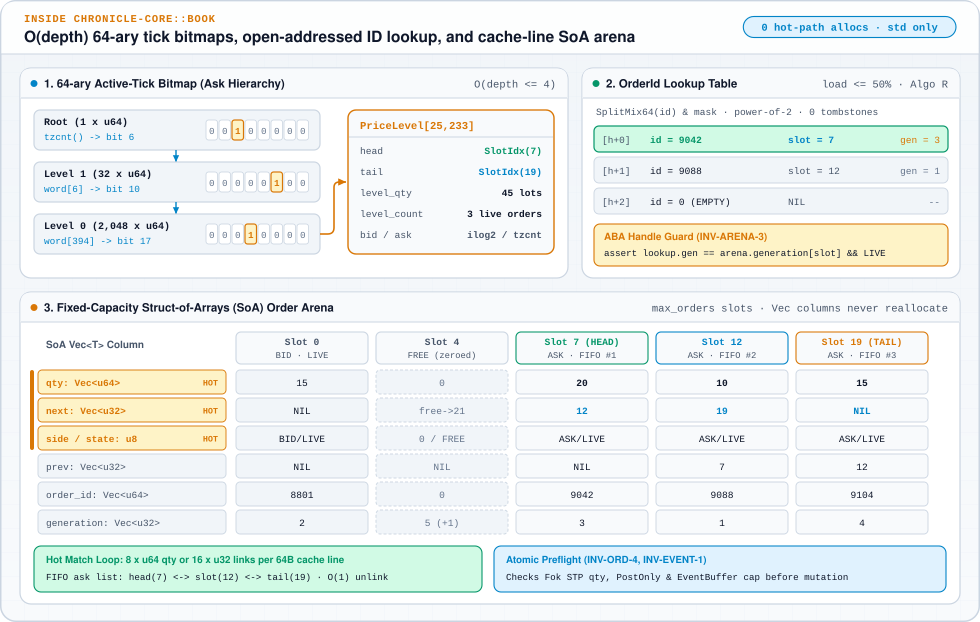
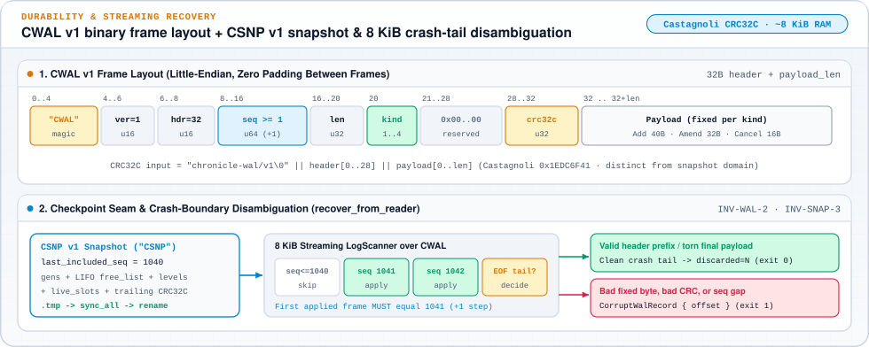

<div align="center">
  <picture>
    <source media="(prefers-color-scheme: dark)" srcset="https://raw.githubusercontent.com/david-engelmann/chronicle-lob/main/docs/media/chronicle-lockup-dark.svg">
    
  </picture>
  <p><strong>Single-threaded, deterministic limit order book, Castagnoli CRC32C write-ahead log, and bounded-memory recovery CLI in safe Rust.</strong></p>
  <p>
    <a href="https://github.com/david-engelmann/chronicle-lob/actions/workflows/ci.yml"></a>
    <a href="https://crates.io/crates/chronicle-core"></a>
    <a href="https://crates.io/crates/chronicle-wal"></a>
    <a href="https://pypi.org/project/chronicle-lob/"></a>
    <a href="https://docs.rs/chronicle-core"></a>
    <a href="https://github.com/david-engelmann/chronicle-lob/blob/main/LICENSE-MIT"></a>
  </p>
  <p>
    <a href="https://david-engelmann.github.io/chronicle-lob/">Documentation Book</a> ·
    <a href="https://github.com/david-engelmann/chronicle-lob/blob/main/docs/ARCHITECTURE.md">Architecture</a> ·
    <a href="https://github.com/david-engelmann/chronicle-lob/blob/main/docs/INVARIANTS.md">Invariants</a> ·
    <a href="https://github.com/david-engelmann/chronicle-lob/blob/main/docs/PERFORMANCE.md">Benchmarks</a> ·
    <a href="https://github.com/david-engelmann/chronicle-lob/blob/main/docs/COMPARISON.md">Comparison</a> ·
    <a href="https://github.com/david-engelmann/chronicle-lob/tree/main/examples">Examples</a>
  </p>
</div>

<p align="center">
  
</p>

`chronicle-lob` prices one instrument on an exact integer tick grid with strict price-time (FIFO) priority. Every capacity bound is fixed at `Book::new`, steady-state matching performs **zero heap allocations** (`INV-ALLOC-1`), `chronicle-core` depends only on the Rust standard library with `#![forbid(unsafe_code)]`, and identical command streams produce byte-identical execution events, WAL frames, and snapshots across platforms (`INV-DET-1`).

---

## Embed in Rust

```toml
[dependencies]
chronicle-core = "0.3"
chronicle-wal = "0.3" # optional: CWAL v1 log, CSNP v1 snapshots, and 8 KiB streaming recovery
```

```rust
use chronicle_core::{
    Book, BookConfig, EventBuffer, ExecutionEvent, OrderId, OrderType, ParticipantId, Side,
    StpPolicy,
};

fn main() -> Result<(), Box<dyn std::error::Error>> {
    let mut book = Book::new(BookConfig {
        max_orders: 65_536,
        grid_len: 4_096, // multiple of 64 in 64..=4_194_304
        tick_size: 1,
        grid_start_tick: 1,
        default_stp: StpPolicy::CancelIncoming,
    })?;

    // Allocate caller-owned event scratch once; reuse across every command on the hot path.
    let mut scratch: Vec<ExecutionEvent> = Vec::with_capacity(64);

    {
        let mut events = EventBuffer::new(&mut scratch);
        book.add_order(
            OrderId(1), ParticipantId(10), Side::Ask, OrderType::PostOnly, 101, 15, None, &mut events,
        )?;
    }
    scratch.clear();

    {
        let mut events = EventBuffer::new(&mut scratch);
        let written = book.add_order(
            OrderId(2), ParticipantId(20), Side::Bid, OrderType::Ioc, 101, 6, None, &mut events,
        )?;
        assert_eq!(written, 2); // ExecutionEvent::Trade + ExecutionEvent::Filled
    }
    scratch.clear();

    assert_eq!(book.best_ask(), Some((101, 9)));
    Ok(())
}
```

### Install the CLI or Python SDK

```sh
# Precompiled Linux / macOS binary verified against SHA256SUMS
curl -fsSL https://raw.githubusercontent.com/david-engelmann/chronicle-lob/main/install.sh | sh

# Cargo / cargo-binstall
cargo install chronicle-lob-cli

# Python 3.9+ SDK + bundled chronicle-cli wheel
pip install chronicle-lob
```

---

## Memory Layout: Bitmaps, Lookup Table, and SoA Arena

<p align="center">
  <picture>
    <source media="(prefers-color-scheme: dark)" srcset="https://raw.githubusercontent.com/david-engelmann/chronicle-lob/main/docs/media/book-memory-layout-dark.svg">
    
  </picture>
</p>

Rather than storing price levels in a `BTreeMap<Price, VecDeque<Order>>` that allocates nodes and chases pointers on bursts, `chronicle-core::Book` pairs three preallocated structures:

1. **64-ary hierarchical active-tick bitmaps (`bitmap.rs`).** Separate bid and ask hierarchies summarize active grid indices in 64-bit words up to a single root `u64` (depth `<= 4` for `grid_len <= 2^22`). Best ask (`trailing_zeros`), best bid (`ilog2`), and L2 neighbour walks (`lowest_above` / `highest_below`) complete in `O(bitmap depth)` word operations regardless of grid sparsity (`INV-BITMAP-1`).
2. **Open-addressed `OrderId` lookup with Knuth Algorithm R (`lookup.rs`).** A fixed power-of-two table (`capacity >= 2 * max_orders`, load factor `<= 50%`) hashes `OrderId` via a fixed `SplitMix64` finalizer and deletes entries by backward shift rather than tombstones, so lookup never degrades across long cancel/add churn (`INV-LOOKUP-1..3`). Every slot dereference checks `lookup.gen == arena.generation[slot]` (`INV-ARENA-3`) to eliminate stale-handle ABA bugs without `unsafe`.
3. **Struct-of-arrays order arena (`arena.rs`).** Parallel `Vec` columns (`qty`, `next`, `side`, `state`, `prev`, `order_id`, `participant`, `price_idx`, `generation`) are sized once to `max_orders`. During an incoming sweep, only the hot columns (`qty`, `next`, `side`) stream through 64-byte cache lines; released slots are zeroed before re-entering the intrusive LIFO free list (`INV-ARENA-2`).
4. **Three-phase atomic preflight (`book.rs`).** Every mutating command (`add_order`, `amend_order`, `cancel_order`, `cancel_by_participant`) validates tick alignment, capacity, STP-adjusted `Fok` executable quantity (`INV-ORD-1`), `PostOnly` crossing (`INV-ORD-2`), and worst-case `EventBuffer` headroom before mutating state. Any error leaves the book and `seq` bit-identical (`INV-ORD-4`, `INV-EVENT-1`). Quantity reductions via `amend_order` preserve FIFO queue priority (`INV-AMEND-1`); price changes or size increases move to the level tail (`INV-AMEND-2`).

---

## Wire Format (`CWAL` v1) & Bounded-Memory Recovery (`CSNP` v1)

<p align="center">
  <picture>
    <source media="(prefers-color-scheme: dark)" srcset="https://raw.githubusercontent.com/david-engelmann/chronicle-lob/main/docs/media/wal-recovery-layout-dark.svg">
    
  </picture>
</p>

`chronicle-wal` persists accepted commands (never rejected attempts or derived events) and structural book snapshots:

- **Domain-separated Castagnoli CRC32C.** Every `CWAL` v1 frame hashes `"chronicle-wal/v1\0" || header[0..28] || payload`, and every `CSNP` v1 snapshot hashes `"chronicle-snapshot/v1\0" || header_and_body`, preventing cross-file or cross-version validation collisions (`INV-WAL-3`).
- **Verbatim structural snapshots.** `CSNP` v1 persists slot generations, `free_list_head`, every free-slot LIFO link, level headers, and live arena records via `.tmp -> sync_all -> rename -> parent dir sync` (`INV-SNAP-2`). Because exact slot assignment and LIFO free-list order are preserved, post-restore mass cancels (`cancel_by_participant`) emit identical event ordering to an uninterrupted process (`INV-SNAP-3`).
- **Sharp crash-boundary vs corruption rules.** `scan_reader_with` and `recover_from_reader` stream multi-gigabyte logs in ~8 KiB of buffer space. A truncated trailing frame whose present fixed bytes match a valid `CWAL` v1 header prefix is classified as a clean crash tail (`discarded=N`, exit `0`); a wrong fixed byte, nonzero reserved field, CRC mismatch, or sequence gap fails with a typed `CorruptWalRecord` or `WalSequenceGap` carrying the exact byte offset (`INV-WAL-2`, exit `1`).

### Operator CLI & Pure-Python Binary Codecs

```sh
# Verify a snapshot + WAL seam in ~8 KiB RAM (exit 0 healthy, 1 corrupt, 2 usage/IO)
chronicle-cli verify --wal session.wal --snapshot session.snap

# Replay deterministic execution events from a snapshot checkpoint
chronicle-cli replay --wal session.wal --snapshot session.snap

# Roll an atomic checkpoint snapshot and archive the covered WAL segment
chronicle-cli checkpoint --wal session.wal --snapshot session.snap --out session.snap

# Run a seeded synthetic workload and emit single-line JSON metrics
chronicle-cli bench --ops 100000 --seed 42 --json
```

The `chronicle_lob` Python package includes zero-dependency pure-Python `CWAL` v1 and `CSNP` v1 codecs alongside typed CLI wrappers:

```python
from pathlib import Path
import chronicle_lob as cl

spec = cl.BookSpec(max_orders=4096, grid_len=1024, tick_size=1, grid_start_tick=1)
wal = Path("session.wal")

builder = cl.WalBuilder()
builder.add_order(order_id=1, participant=7, side="bid", order_type="limit", price=99, qty=10)
builder.add_order(order_id=2, participant=8, side="ask", order_type="ioc", price=99, qty=4)
builder.write(wal)

frames = cl.read_wal_frames(wal)          # verifies "chronicle-wal/v1\0" CRC32C in pure Python
verdict = cl.verify(wal, spec=spec)       # drives chronicle-cli verify
replay = cl.replay(wal, spec=spec)        # parses <seq> <event> records
assert verdict.ok and len(frames) == 2
```

---

## Verification & Differential Oracles

Every guarantee in [`docs/INVARIANTS.md`](https://github.com/david-engelmann/chronicle-lob/blob/main/docs/INVARIANTS.md) is enforced in CI on Linux, macOS, and Windows:

- **Steady-state zero-allocation proof (`alloc_proof.rs`).** A counting global allocator runs `1,000,000` mixed adds, matches, amends, cancels, depth snapshots, and `EventBuffer` drains after `Book::new` and asserts `0` allocations and `0` bytes (`INV-ALLOC-1..3`).
- **Dual-seed differential `ReferenceBook` sweeps.** `10,000 x 2` seeded `proptest` command sequences compare `chronicle-core::Book` event-for-event and level-for-level against an independent `BTreeMap` + `VecDeque` oracle (`INV-BOOK-1..5`).
- **Crash-tail & byte-flip fault matrix.** Exhaustive truncation and byte-corruption tests exercise every row of the `CWAL` v1 and `CSNP` v1 disambiguation tables (`INV-WAL-2`, `INV-SNAP-1`), complemented by standalone `cargo-fuzz` targets under [`fuzz/`](https://github.com/david-engelmann/chronicle-lob/tree/main/fuzz).
- **Source determinism scan (`INV-DET-1`).** CI scans `chronicle-core` and `chronicle-wal` source text to forbid `SystemTime`, `Instant`, `thread_rng`, `RandomState`, `DefaultHasher`, `HashMap`, and `HashSet`.
- **Recorded latency and throughput baselines.** Criterion microbenchmark baselines with commit and hardware provenance live exclusively in [`docs/PERFORMANCE.md`](https://github.com/david-engelmann/chronicle-lob/blob/main/docs/PERFORMANCE.md) (`CHECK-DOC-1`).

---

## Workspace Crates & Reference Docs

| Package | Registry | Scope |
| --- | --- | --- |
| [`chronicle-core`](https://github.com/david-engelmann/chronicle-lob/blob/main/crates/chronicle-core/README.md) | [crates.io](https://crates.io/crates/chronicle-core) · [docs.rs](https://docs.rs/chronicle-core) | Zero-dependency matching engine, 64-ary bitmaps, SoA arena, and `EventBuffer` (`#![forbid(unsafe_code)]`). |
| [`chronicle-wal`](https://github.com/david-engelmann/chronicle-lob/blob/main/crates/chronicle-wal/README.md) | [crates.io](https://crates.io/crates/chronicle-wal) · [docs.rs](https://docs.rs/chronicle-wal) | `CWAL` v1 writer/scanner, atomic `CSNP` v1 snapshots, and ~8 KiB streaming crash recovery (`std` only). |
| [`chronicle-lob-cli`](https://github.com/david-engelmann/chronicle-lob/blob/main/crates/chronicle-cli/README.md) | [crates.io](https://crates.io/crates/chronicle-lob-cli) · [docs.rs](https://docs.rs/chronicle-lob-cli) | `chronicle-cli` binary (`verify`, `replay`, `snapshot`, `checkpoint`, `bench`, `completions`). |
| [`chronicle-lob`](https://pypi.org/project/chronicle-lob/) | [PyPI](https://pypi.org/project/chronicle-lob/) | Pure-Python `CWAL` / `CSNP` binary codecs and typed `chronicle-cli` SDK. |

- **Specifications:** [`docs/ARCHITECTURE.md`](https://github.com/david-engelmann/chronicle-lob/blob/main/docs/ARCHITECTURE.md) · [`docs/INVARIANTS.md`](https://github.com/david-engelmann/chronicle-lob/blob/main/docs/INVARIANTS.md) · [`docs/PERFORMANCE.md`](https://github.com/david-engelmann/chronicle-lob/blob/main/docs/PERFORMANCE.md)
- **Guides & Context:** [Published Documentation Book](https://david-engelmann.github.io/chronicle-lob/) · [`docs/COMPARISON.md`](https://github.com/david-engelmann/chronicle-lob/blob/main/docs/COMPARISON.md) · [`docs/FAQ.md`](https://github.com/david-engelmann/chronicle-lob/blob/main/docs/FAQ.md) · [`examples/`](https://github.com/david-engelmann/chronicle-lob/tree/main/examples) · [`AGENTS.md`](https://github.com/david-engelmann/chronicle-lob/blob/main/AGENTS.md)
- **Project Policies:** [`SECURITY.md`](https://github.com/david-engelmann/chronicle-lob/blob/main/SECURITY.md) · [`CONTRIBUTING.md`](https://github.com/david-engelmann/chronicle-lob/blob/main/CONTRIBUTING.md) · [`CHANGELOG.md`](https://github.com/david-engelmann/chronicle-lob/blob/main/CHANGELOG.md)

## License

Licensed under either of [Apache License, Version 2.0](https://github.com/david-engelmann/chronicle-lob/blob/main/LICENSE-APACHE) or [MIT License](https://github.com/david-engelmann/chronicle-lob/blob/main/LICENSE-MIT), at your option.
