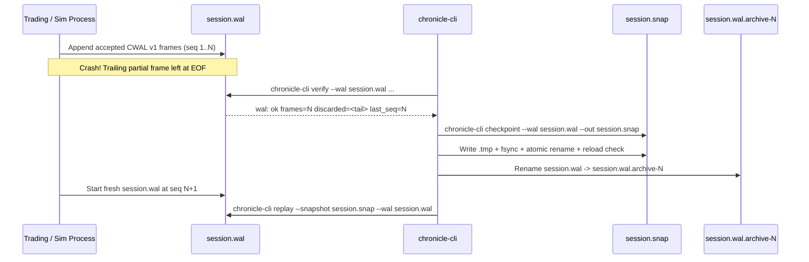

# CLI and Python SDK

`chronicle-lob` ships two high-level operational surfaces around the Rust engine and persistence crates:

1. **`chronicle-cli`** (from crates.io package `chronicle-lob-cli`), a zero-unsafe operator binary for verifying, replaying, snapshotting, checkpointing, and benchmarking session files in ~8 KiB of streaming buffer memory.
2. **`chronicle_lob`** (from PyPI package `chronicle-lob`), a zero-dependency typed Python SDK containing pure-Python `CWAL` v1 and `CSNP` v1 binary codecs alongside subprocess wrappers for `chronicle-cli`.

## `chronicle-cli` subcommand reference

Every subcommand accepts `--seed <U64>` (default `0`) and honours the `SIM_SEED` environment variable (`INV-DET-2`). Output field ordering is deterministic across platforms.

| Subcommand | Purpose | Required flags |
| --- | --- | --- |
| `verify` | Stream-scan a WAL (and optional base snapshot) to validate magic, header invariants, sequence continuity, and Castagnoli CRC32C checksums. | `--wal <PATH>` plus either `--snapshot <PATH>` or grid flags |
| `replay` | Stream a WAL onto a fresh or snapshot-backed `Book` and write `seed=<N>` followed by formatted `ExecutionEvent` lines to `stdout` (exits `0` cleanly on `BrokenPipe`). | `--wal <PATH>` plus either `--snapshot <PATH>` or grid flags |
| `snapshot` | Stream-recover a `Book` from a WAL (and optional base snapshot) and write an atomic `CSNP` v1 snapshot via `.tmp` write, `fsync`, and `rename`. | `--wal <PATH>`, `--out <PATH>`, plus either `--snapshot <PATH>` or grid flags |
| `checkpoint` | Write a new snapshot, verify it by reloading and checking `next_seq` from disk, and only then rename `<wal>` to `<wal>.archive-<last_included_seq>`. | `--wal <PATH>`, `--out <PATH>`, plus either `--snapshot <PATH>` or grid flags |
| `bench` | Run `N` deterministic `SplitMix64`-generated commands (`Limit`, `Ioc`, `Fok`, `PostOnly`, amends, cancels, mass cancels) against a `65,536`-slot book. | Optional `--ops <N>`, `--seed <U64>`, `--json` |
| `completions` | Emit deterministic shell completion script to `stdout`. | `<bash\|zsh\|fish\|powershell\|pwsh>` |

### Grid flags vs `--snapshot`

When starting from a genesis write-ahead log (`seq = 1`) without a base snapshot, pass explicit grid flags:

```sh
chronicle-cli verify \
  --wal session.wal \
  --max-orders 1024 \
  --grid-len 4096 \
  --tick-size 1 \
  --grid-start-tick 1 \
  --default-stp cancel-incoming
```

Once a snapshot exists, its 64-byte `CSNP` v1 header carries the exact `BookConfig`. Pass `--snapshot` instead of grid flags (supplying both is rejected with exit code `2` so configuration mismatches cannot slip through):

```sh
chronicle-cli verify --wal session.wal --snapshot session.snap
chronicle-cli replay --seed 42 --wal session.wal --snapshot session.snap
```

### Exit codes

| Code | Condition | Behaviour |
| --- | --- | --- |
| `0` | Healthy / complete | `verify` prints `verdict: ok` (reporting any clean crash-tail truncation in `discarded=<N>`); `replay`, `snapshot`, `checkpoint`, `bench`, and `completions` completed cleanly. |
| `1` | Corrupt WAL or snapshot | `verify` encountered bad magic/version, nonzero reserved bytes, sequence gap, CRC32C mismatch, or structural snapshot corruption (`verdict: corrupt ...`). |
| `2` | Usage, I/O, or replay error | Invalid flags, missing files, or a command rejected by book preflight during `replay` (`error: ...` on `stderr`). |

### Checkpoint and crash-recovery lifecycle

`checkpoint` supports safe multi-cycle in-place updates (`--snapshot book.snap --out book.snap`) because the base snapshot is decoded into memory before writing `.tmp`, syncing, reloading to verify `next_seq`, and archiving the covered WAL segment:



## `chronicle_lob` Python SDK

The Python package requires Python `>= 3.10` and zero third-party Python dependencies.

### Pure-Python `CWAL` v1 and `CSNP` v1 codecs

You can synthesize, inspect, and checksum-validate binary WAL logs and snapshot headers purely in Python without spawning a subprocess:

```python
import chronicle_lob

# Encode accepted commands into CWAL v1 binary frames.
wal = chronicle_lob.WalBuilder(start_seq=1)
wal.add(order_id=1, participant=10, side="bid", price=100, qty=15)
wal.add(
    order_id=2,
    participant=20,
    side="ask",
    price=102,
    qty=10,
    order_type="post-only",
    stp="cancel-both",
)
wal.amend(order_id=1, new_price=101, new_qty=12)

# Decode and verify every frame header, reserved field, sequence step, and CRC32C.
frames = chronicle_lob.read_wal_frames(wal.to_bytes())
for frame in frames:
    print(frame.sequence, frame.command_type, frame.price, frame.qty, hex(frame.crc32c))
```

Key pure-Python types and functions:
- `WalBuilder(start_seq=1)`: `.add(...)`, `.amend(...)`, `.cancel(...)`, `.cancel_by_participant(...)`, `.to_bytes()`, `.write(path)`.
- `read_wal_frames(source)` and `iter_wal_frames(source)`: accept `bytes` or `Path`, validate `CWAL` v1 headers, reserved zero bytes, sequence continuity, and domain-separated CRC32C checksums, returning `WalFrame` dataclasses (or raising `ChronicleError` with exact byte offset).
- `read_snapshot_header(source)`: validates the 64-byte `CSNP` v1 header, expected file byte length (`68 + 8 * max_orders + 20 * grid_len + 56 * live_order_count`), and trailing domain-separated CRC32C over the entire snapshot payload, returning `SnapshotHeader`.
- `crc32c(data)`: pure-Python Castagnoli CRC32C implementation matching `chronicle_wal::crc32c`.

### Driving `chronicle-cli` from Python

Typed wrapper functions locate `chronicle-cli` automatically (checking explicit `binary=`, `CHRONICLE_CLI_BIN`, active Python environment `bin/`/`Scripts/`, repository `target/release` and `target/debug`, and `PATH`):

```python
from pathlib import Path
import tempfile
import chronicle_lob

spec = chronicle_lob.BookSpec(
    max_orders=64,
    grid_len=640,
    tick_size=1,
    grid_start_tick=1,
    default_stp="cancel-incoming",
)

with tempfile.TemporaryDirectory() as tmp:
    tmp_dir = Path(tmp)
    wal = chronicle_lob.WalBuilder()
    wal.add(order_id=1, participant=10, side="bid", price=100, qty=10)
    wal.add(order_id=2, participant=20, side="ask", price=100, qty=4)
    wal_path = wal.write(tmp_dir / "session.wal")
    snap_path = tmp_dir / "session.snap"

    ver = chronicle_lob.verify(wal_path, config=spec)
    assert ver.ok and ver.frames == 2

    snap = chronicle_lob.snapshot(wal_path, snap_path, config=spec)
    assert snap.last_included_seq == 2 and snap.live_orders == 1

    rep = chronicle_lob.replay(wal_path, config=spec, seed=42)
    assert [ev.kind for ev in rep.events] == ["accepted", "trade", "filled"]
```

For full runnable scripts, see [`examples/market_session_and_replay.py`](https://github.com/david-engelmann/chronicle-lob/blob/main/examples/market_session_and_replay.py) and [`examples/crash_recovery_drill.sh`](https://github.com/david-engelmann/chronicle-lob/blob/main/examples/crash_recovery_drill.sh).
