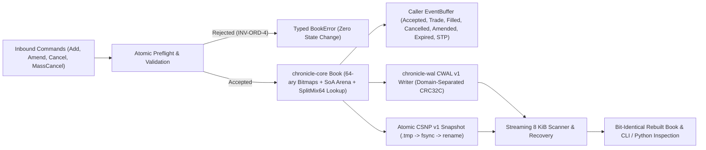

# chronicle-lob

`chronicle-lob` is a single-threaded, deterministic limit order book and matching engine written in Rust with zero steady-state heap allocation, backed by a Castagnoli CRC32C write-ahead log, atomic snapshots, an operator CLI, and a typed Python SDK.

  

## Core design properties

- **Strict price-time priority on an integer tick grid.** Orders rest on a configured `u64` tick grid and match by best price first and FIFO arrival order second, always executing at the resting maker price (`INV-BOOK-1` through `INV-BOOK-4`). Checked `u128` intermediates prevent arithmetic overflow (`INV-MATH-1`).
- **Zero steady-state heap allocation.** Resting orders live in a preallocated struct-of-arrays (SoA) arena addressed by generation-checked 32-bit slot indices (`INV-ALLOC-1`, `INV-ARENA-3`). Active price ticks sit under a 64-ary hierarchical bitmap (`O(bitmap depth)` best-price and sparse depth queries), `OrderId` lookup uses a 50-percent-load open-addressed table with Knuth Algorithm R backward-shift deletion (`INV-LOOKUP-1`, `INV-LOOKUP-2`), and execution events write into a caller-owned `EventBuffer`.
- **Atomic preflight validation.** Every mutating command validates grid bounds, arena capacity, Fill-or-Kill (`Fok`) STP-adjusted liquidity, `PostOnly` spread crossing, and `EventBuffer` headroom before mutating state. Any rejected command leaves book state and sequence numbers bit-identical (`INV-ORD-4`, `INV-EVENT-1`).
- **Crash-safe binary durability in ~8 KiB of streaming memory.** `chronicle-wal` encodes accepted commands as domain-separated CRC32C `CWAL` v1 frames, saves `CSNP` v1 structural snapshots through an atomic write-sync-rename protocol (`INV-SNAP-2`), validates every snapshot invariant unconditionally in both debug and release builds (`INV-SNAP-1`), and streams verification and crash recovery in fixed 8 KiB chunks.
- **Pure standard-library core.** `chronicle-core` has zero external runtime dependencies, forbids `unsafe` code, reads no wall or monotonic clock, and touches no process-seeded randomness (`INV-DET-1`).

## End-to-end data flow

## Workspace layout

| Component | Package | Surface |
| --- | --- | --- |
| Matching core | [`chronicle-core`](https://crates.io/crates/chronicle-core) | `Book`, `BookConfig`, `EventBuffer`, `ExecutionEvent`, `OrderType` (`Limit`, `Ioc`, `Fok`, `PostOnly`), `StpPolicy`, L2/L3 zero-allocation queries (`std` only, zero external crates). |
| Persistence and recovery | [`chronicle-wal`](https://crates.io/crates/chronicle-wal) | `WalWriter`, `WalCommand`, `LogScanner`, `scan_reader_with`, `save_snapshot`, `save_snapshot_with_buffer`, `decode_snapshot`, `recover_from_reader` (`std` only). |
| Operator CLI | [`chronicle-lob-cli`](https://crates.io/crates/chronicle-lob-cli) | `chronicle-cli` binary and library (`verify`, `replay`, `snapshot`, `checkpoint`, `bench`, `completions`). |
| Python SDK | [`chronicle-lob`](https://pypi.org/project/chronicle-lob/) | Pure-Python `CWAL` v1 / `CSNP` v1 binary codecs (`WalBuilder`, `read_wal_frames`, `read_snapshot_header`) and typed `chronicle-cli` wrappers. |

## Where to go next

- **[Quickstart](./quickstart.md)** walks through installing `chronicle-cli`, embedding `chronicle-core` and `chronicle-wal` in Rust, and running the end-to-end repository examples.
- **[CLI and Python SDK](./cli-and-python.md)** documents every `chronicle-cli` subcommand, exit code, checkpoint workflow, and `chronicle_lob` Python API.
- **[Architecture](docs/ARCHITECTURE.md)** specifies the arena columns, 64-ary bitmap hierarchy, open-addressed hash table, `CWAL` v1 frame bytes, and `CSNP` v1 snapshot layout.
- **[Invariants and Traceability](docs/INVARIANTS.md)** maps every normative `INV-*` guarantee to the exact property test, mutation harness, or counting-allocator proof that enforces it in CI.
- **[Performance Baselines](docs/PERFORMANCE.md)** records Criterion microbenchmark latency and throughput measurements with commit and runner provenance (`CHECK-DOC-1`).
- **[How chronicle-lob Compares](docs/COMPARISON.md)** contrasts `chronicle-lob` against `BTreeMap` order books, ring-buffer pipelines, and floating-point backtesters.
- **[Frequently Asked Questions](docs/FAQ.md)** answers common design, persistence, and operational questions.
